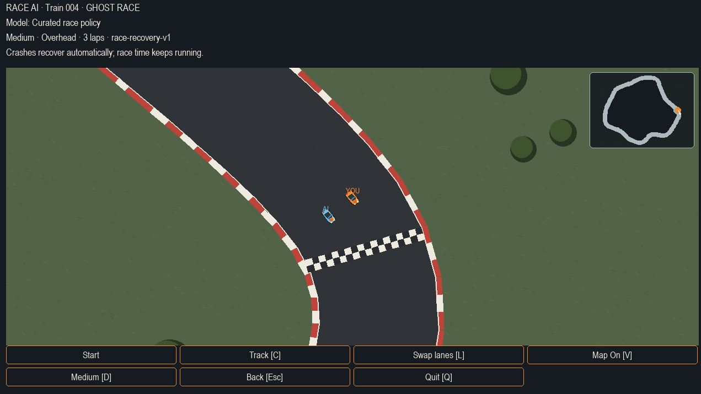
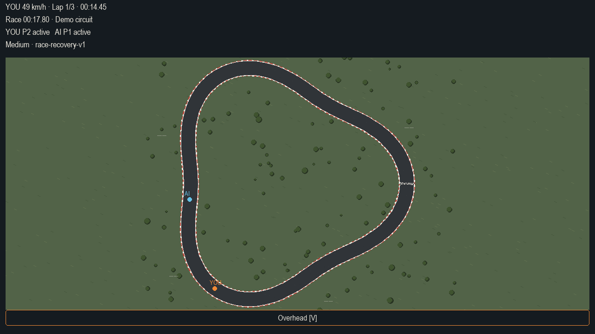
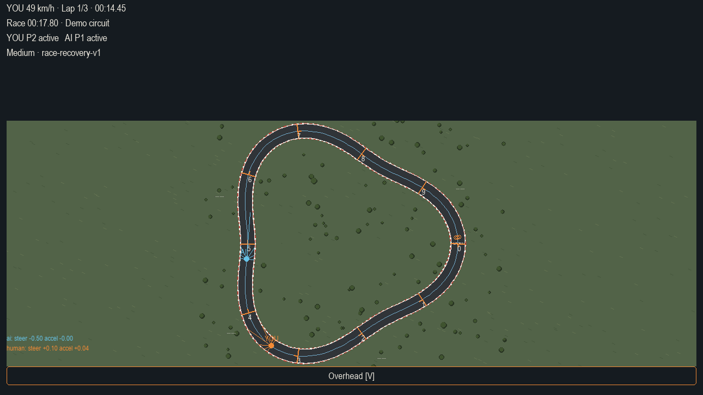
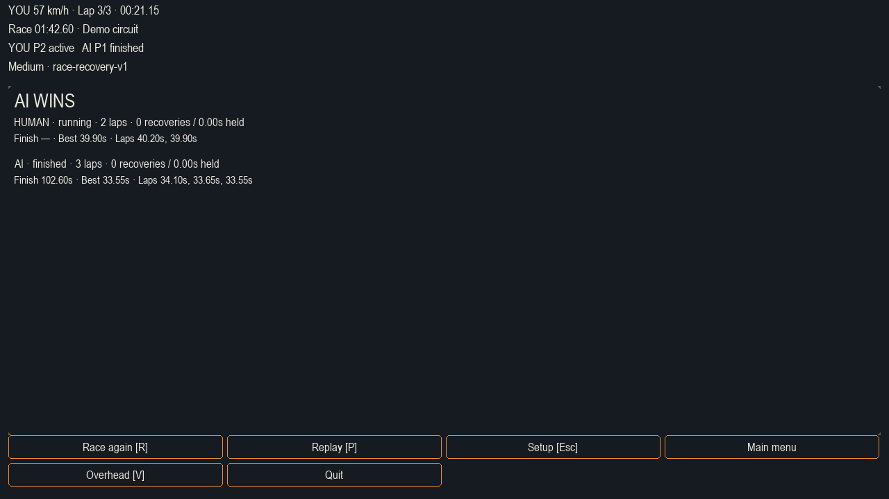
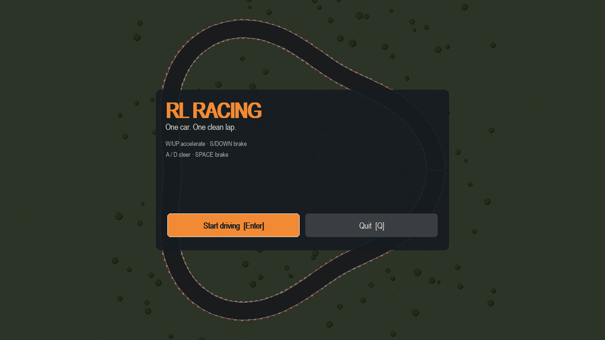

# AI Racing 🏎️💨

[](https://www.python.org/downloads/)
[](LICENSE)
[](https://gymnasium.farama.org/)
[](https://stable-baselines3.readthedocs.io/)
[](https://www.pygame.org/)

**AI Racing** is a deterministic 2D top-down racing simulation and reinforcement learning platform built in Python. It features a playable human-vs-AI desktop mode, deterministic physics engine, LiDAR sensor simulation, multi-agent racing, replay recording/playback, and full Gymnasium environments compatible with Stable-Baselines3.

---

## Screenshots & Previews

<div align="center">
  <table align="center">
    <tr>
      <td align="center"><b>Human vs AI (Ghost Race / Follow Cam)</b></td>
      <td align="center"><b>Full Track View (Overhead Mode)</b></td>
    </tr>
    <tr>
      <td></td>
      <td></td>
    </tr>
    <tr>
      <td align="center"><b>Real-Time LiDAR Raycast Sensors & Telemetry</b></td>
      <td align="center"><b>Race Results & Lap Telemetry</b></td>
    </tr>
    <tr>
      <td></td>
      <td></td>
    </tr>
  </table>

  <br/>
  <h3>Interactive Desktop Launcher & Menu</h3>
  
</div>

---

## Features

- **Playable Desktop Racing App**: Smooth 60 FPS Pygame interface with human driving, opponent AI, customizable camera modes (follow / overhead), replay viewer, and track selector.
- **Reinforcement Learning**:
  - Continuous observation space: raycast LiDAR distances, speed, slip angle, track curvature, opponent relative distance & bearing.
  - Gym-compliant environment (`gymnasium.Env`) supporting single-car time trials and competitive multi-agent racing.
  - Pre-trained PPO checkpoints and models included under `runs/`.
- **Deterministic 2D Physics**:
  - Custom discrete physics simulation with lateral tire slip, friction, drag, and steering dynamics.
  - 100% reproducible race traces and replay validation.
- **Procedural Track Generation**:
  - Curvature-constrained procedural spline track generator with boundary extrusion and sector split timing.
  - 100+ generated training, validation, and test tracks included in `assets/tracks/`.
- **Windows Standalone Executable**:
  - Build script and PyInstaller spec (`AIRacing.spec`) to package the simulator into a standalone Windows app without needing Python installed.

---

## Quick Start

### 1. Prerequisites & Installation

Clone the repository and install dependencies in a virtual environment:

```powershell
# Clone the repository
git clone https://github.com/SheyBoiCarti/RL-Racing.git
cd RL-Racing

# Create and activate a virtual environment
python -m venv .venv
.venv\Scripts\activate   # On Linux/macOS: source .venv/bin/activate

# Install package with development & RL dependencies
pip install -e ".[dev,rl]"
```

### 2. Launch the Desktop Game

Run the entry point:

```powershell
racing-play
```

Or run via python module:

```powershell
python -m racing.render.app
```

---

## Controls

| Key | Action |
| --- | --- |
| <kbd>W</kbd> / <kbd>▲ Up</kbd> | Accelerate / Throttle |
| <kbd>S</kbd> / <kbd>▼ Down</kbd> | Brake / Reverse |
| <kbd>A</kbd> / <kbd>◄ Left</kbd> | Steer Left |
| <kbd>D</kbd> / <kbd>► Right</kbd> | Steer Right |
| <kbd>C</kbd> | Toggle Camera Mode (Follow / Overhead) |
| <kbd>L</kbd> | Toggle LiDAR Raycast Sensor Display |
| <kbd>P</kbd> | Pause / Resume |
| <kbd>R</kbd> | Restart Race / Recover to Track |
| <kbd>Esc</kbd> | Return to Menu / Exit |

---

## Training & Evaluation

Train a PPO agent locally:

```powershell
python scripts/train.py --config configs/train_ppo.yaml
```

Evaluate pre-trained policies against baselines:

```powershell
python scripts/evaluate.py --model runs/kaggle-phase04-single-full-import/phase04-single/best_model.zip
```

Inspect race replays or verify deterministic physics:

```powershell
python scripts/verify_race.py
```

---

## Building Standalone Windows Executable

To compile into a standalone Windows binary:

```powershell
pip install pyinstaller
pyinstaller --noconfirm AIRacing.spec
```

The compiled executable and dependencies will be generated in `dist/AIRacing/AIRacing.exe`.

---

## Running Tests

Ensure all unit, smoke, and integration tests pass:

```powershell
python -m pytest tests -q
python -m ruff check .
```

---

## License

This project is licensed under the MIT License - see the [LICENSE](LICENSE) file for details.
